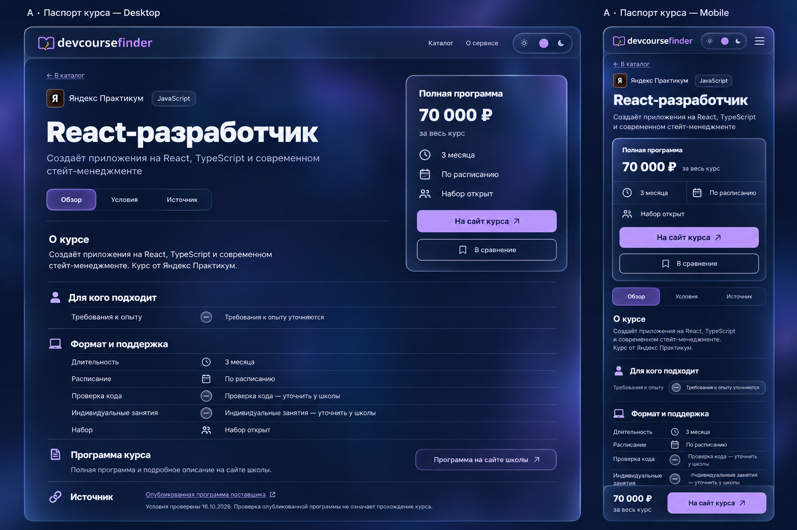
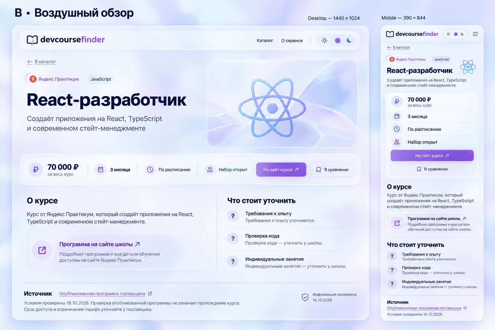
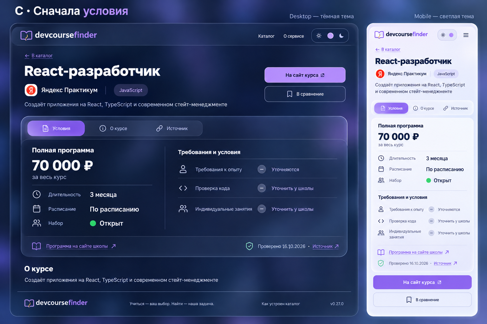

# Эскизы страницы курса

Три концепта страницы React-разработчик. В каждом — десктопная и мобильная компоновки. Это эскизы для выбора направления, не скриншоты реализованных изменений.

## A — Паспорт курса

Цена и действия справа, подробности слева.

## B — Воздушный обзор

Светлая тема, просторная композиция и общая панель основных условий.

## C — Сначала условия

Цена, формат и неподтверждённые условия собраны в одном блоке.

